<div align="center">
  <a href="https://panda-softs.github.io/PixNab/">
    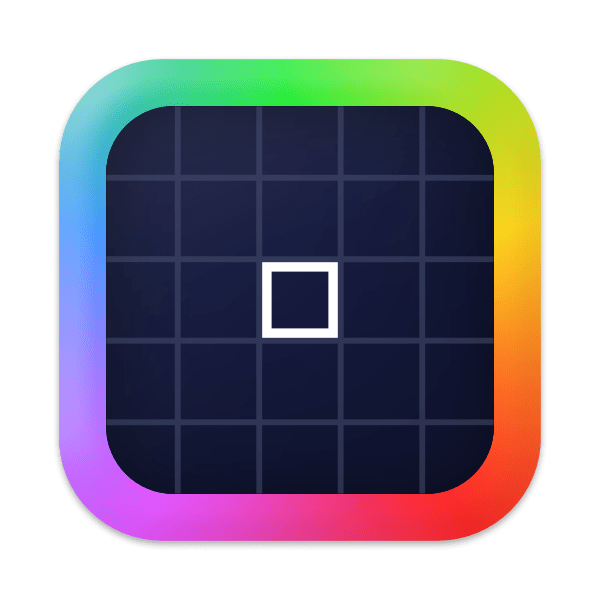
  </a>

  # PixNab

  **The premium native color picker and color studio for macOS.**

  Pick colors with pixel precision. Explore palettes, build accessible interfaces, generate color scales, and export colors to the tools you use every day.

  [](https://github.com/Panda-Softs/PixNab/releases/latest)
  [](https://github.com/Panda-Softs/PixNab)
  [](https://github.com/Panda-Softs/PixNab)

  **[Product website](https://panda-softs.github.io/PixNab/)** · **[Download latest release](https://github.com/Panda-Softs/PixNab/releases/latest)** · **[Report an issue](https://github.com/Panda-Softs/PixNab/issues)**
</div>

---

## Overview

PixNab is a lightweight **menu-bar application for macOS 14 and later**, built with **Swift, AppKit, SwiftUI, and ScreenCaptureKit**. It combines a screen color picker with a dedicated **Color Studio**, a native **Color Wheel**, a format browser, and practical tools for modern design workflows.

- **Pixel-perfect picking** with a circular magnifier, fine keyboard movement, adjustable zoom, and multi-pick sessions.
- **300 curated and generated web-design palettes**, available offline.
- **Five color harmonies** in a native interactive color wheel.
- **11-step OKLCH color scales** and exportable design tokens.
- **Independent color comparison** using CIEDE2000 (ΔE00) and OKLab distance.
- **33 copyable text formats**, plus **Adobe ASE and ACO swatch export**.
- **Local history, favorites, saved palettes, configurable shortcuts, and English/French UI**.

### PixNab in action

<table>
  <tr>
    <td width="55%">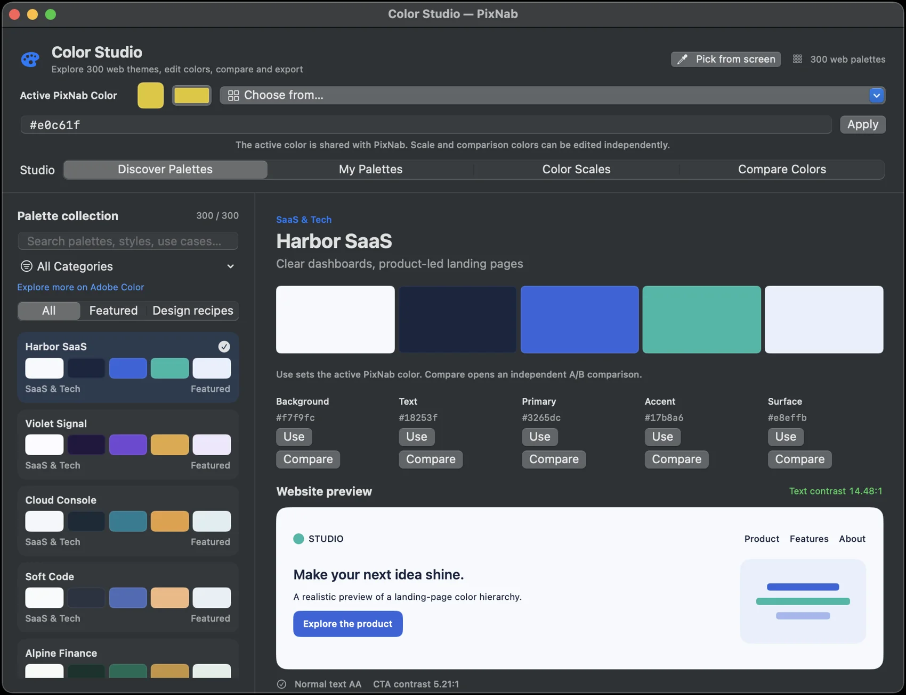</td>
    <td width="45%">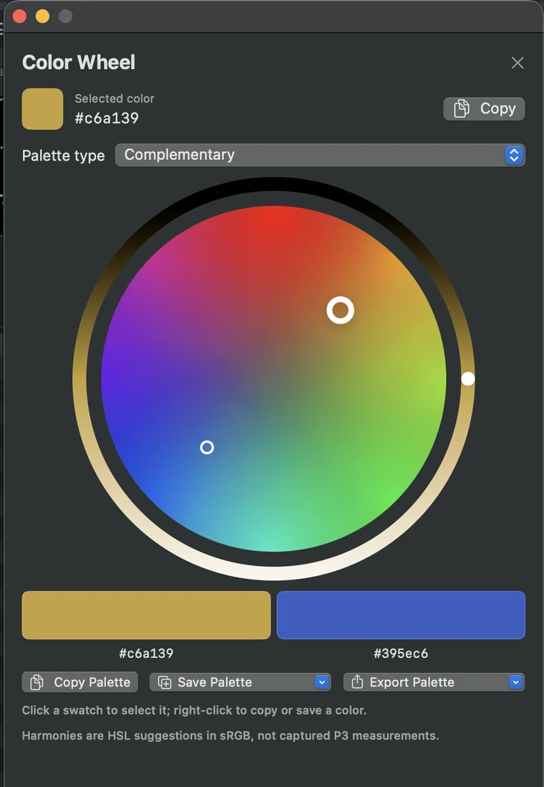</td>
  </tr>
  <tr>
    <td align="center"><strong>Color Studio</strong> — explore, preview and reuse palettes</td>
    <td align="center"><strong>Color Wheel</strong> — discover harmonies interactively</td>
  </tr>
</table>

Explore the full experience, interactive color demonstrations and more screenshots on the **[PixNab website](https://panda-softs.github.io/PixNab/)**.

## Download and installation

### Latest release — v0.23.0

**[Download PixNab from GitHub Releases](https://github.com/Panda-Softs/PixNab/releases/latest)**

1. Open the latest release and download its **`.dmg`** file (for v0.23.0, `PixNab-v0.23.0.dmg`, if that is the asset name shown).
2. Open the downloaded DMG.
3. Drag **PixNab.app** to **Applications**.
4. Launch PixNab from Applications. Its icon appears in the macOS menu bar.
5. When prompted, grant **Screen Recording** permission in **System Settings → Privacy & Security → Screen Recording** so PixNab can read pixels for color picking.

> **macOS security notice:** This release may be distributed with an **ad-hoc code signature rather than Apple Developer ID notarization**. Gatekeeper may block the first launch. If you obtained the DMG from the official repository and trust it, attempt to open PixNab, then use **System Settings → Privacy & Security → Open Anyway** if macOS offers that option. Do not disable Gatekeeper globally. A self-signed or ad-hoc signature does not provide Apple Developer ID verification.

**Requirements:** macOS **14.0 or newer**. Check the release assets and release notes for the architectures included in a particular DMG; a locally built Apple Silicon application is not necessarily a universal binary.

## Features

### 1. Precision Screen Color Picker

Select a color anywhere on your screen using a responsive circular magnifier designed for individual-pixel sampling.

- Pixel-grid zoom with a central selection reticle and an optional format/value overlay **inside the lens**.
- Move the selection by mouse or **arrow keys** for precise positioning.
- Change magnification by scrolling; use **Option + scroll** to adjust the lens diameter.
- Hold **Shift** or **Control** to activate precision mode; long-press also supports fine control.
- Hold **Command** and click repeatedly to collect multiple colors in one session; a standard click completes the session.
- Undo the last collected sample with **Command-Z** or **Delete**, or cancel with **Escape**.
- Select the default clipboard format and optionally choose a format after picking.
- Set capture performance to **15 or 30 FPS**; capture runs when the picker is active, rather than continuously in the background.

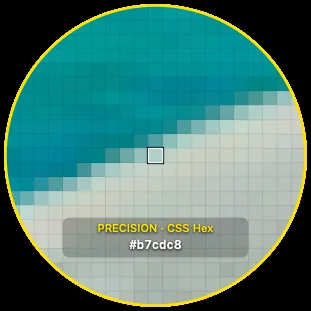

> **Multiple displays:** PixNab supports screen selection and display-aware capture. Precise positioning across monitor boundaries is hardware- and arrangement-dependent; if you encounter a problem, please [report your monitor layout and macOS version](https://github.com/Panda-Softs/PixNab/issues). Do not assume smooth cross-display behavior is verified on every setup.

### 2. Color Studio — 300 palettes

Color Studio is a separate native window with four workspaces: **Discover Palettes**, **My Palettes**, **Color Scales**, and **Compare Colors**.

**Discover Palettes**

- Browse **300 offline web-design palettes**: **30 featured palettes** and **270 original PixNab design recipes**.
- Explore **nine design sectors**, search by name and use case, and filter featured palettes or design recipes.
- View semantic roles — **Background, Text, Primary, Accent, and Surface** — and a realistic sample website preview.
- Inspect text and call-to-action contrast information; select a shade with **Use** or compare it without modifying the active color.
- Start an OKLCH scale from a palette's Primary color.

**My Palettes**

- Save your own named collections and manage colors independently of recent capture history.
- Rename, duplicate, reorder, edit, and delete saved palettes.
- Import/export a local palette library as JSON; export colors and swatches for other creative tools.

**Shared color workflow**

- Edit the active PixNab color using HEX/CSS input, the native macOS color panel, recent samples, a palette shade, or a fresh screen pick.
- Changes to comparison colors or a scale base remain independent until you explicitly activate a result.

<table>
  <tr>
    <td>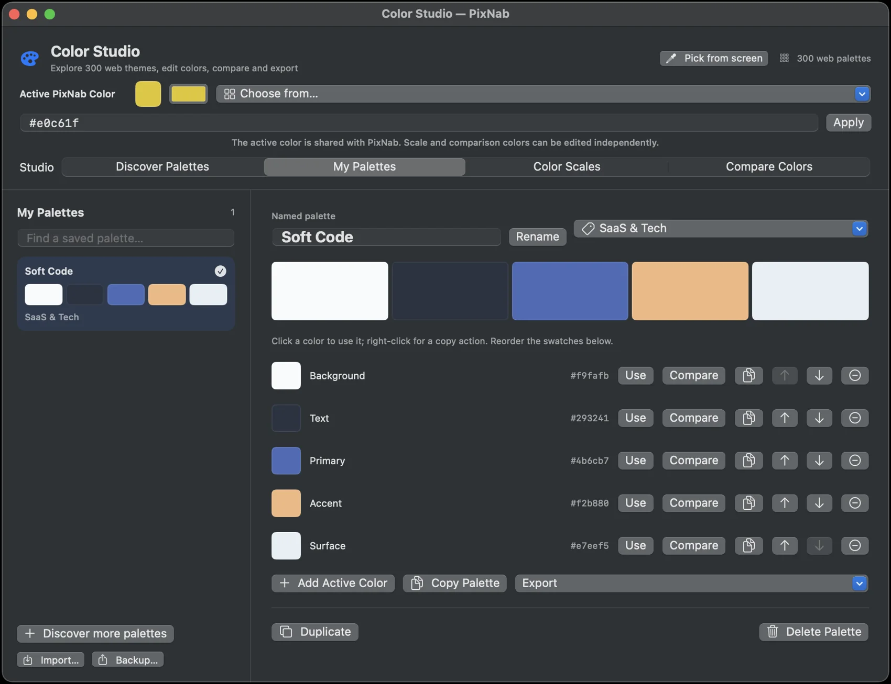</td>
    <td>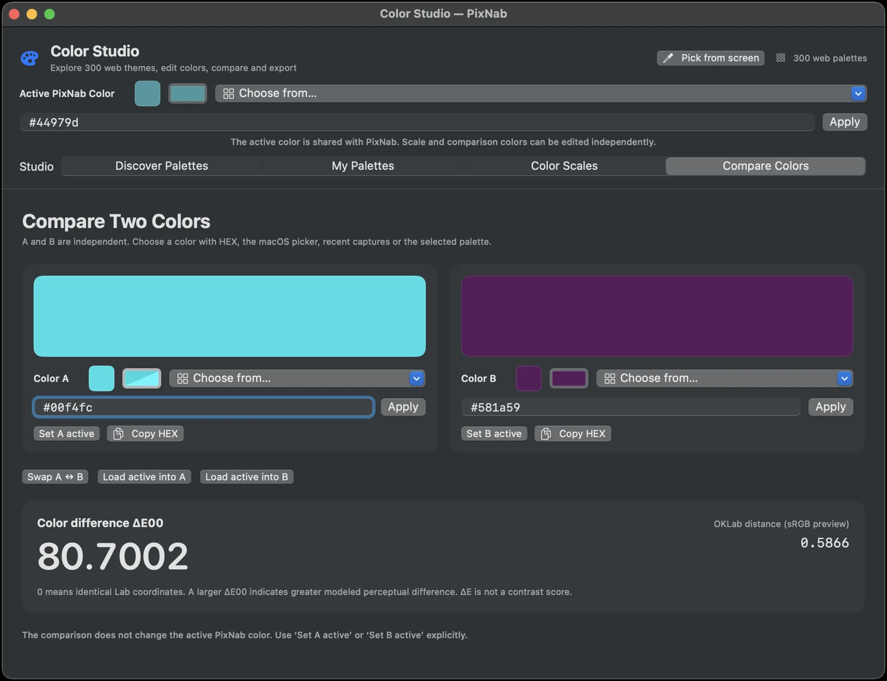</td>
  </tr>
  <tr>
    <td align="center"><strong>My Palettes</strong></td>
    <td align="center"><strong>Compare Colors</strong></td>
  </tr>
</table>

### 3. Native Color Wheel and color harmonies

Create cohesive palettes from a selected color in a dedicated native window.

- Interactive color disk for selecting **hue and saturation**, with a separate **HSL lightness** control.
- Five harmony modes: **Complementary, Analogous, Triadic, Tetradic, and Monochromatic**.
- Update the generated swatches as you adjust the color.
- Click a swatch to use it; right-click to copy or save an individual color.
- **Copy Palette**, **Save Palette**, and **Export Palette** operations, including ASE/ACO swatches.

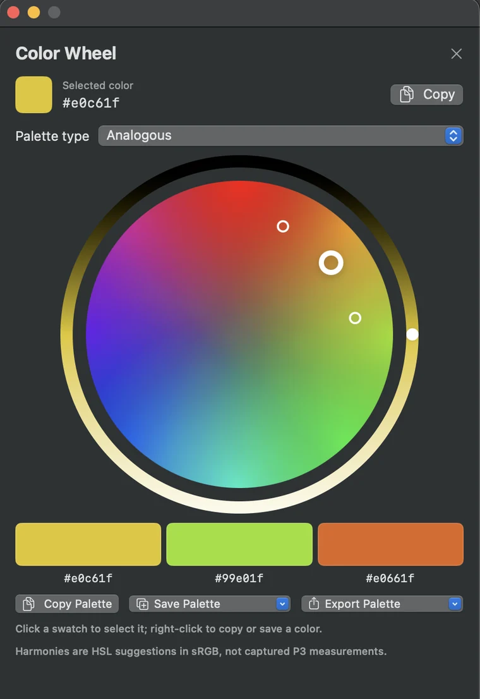

> Harmonic colors are design suggestions computed in sRGB/HSL. They are not color measurements from a captured Display P3 pixel. HSL lightness is not the same as perceptual lightness.

### 4. OKLCH color scales and design tokens

Generate a systematic tonal scale from any chosen base color.

- **11 labeled shades:** `50`, `100`, `200`, `300`, `400`, `500`, `600`, `700`, `800`, `900`, `950`.
- The original selected color remains at **step 500**.
- OKLCH-based generation with sRGB gamut handling.
- Copy or export semantic tokens for **CSS**, **JSON**, and **SwiftUI**.
- Use an individual shade in PixNab, or save the generated palette for later.

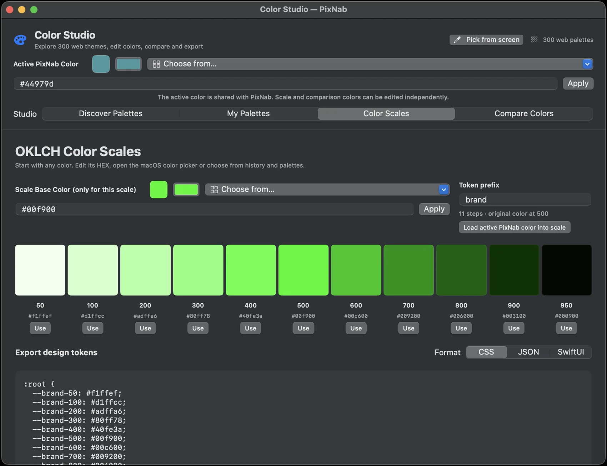

### 5. Color comparison — ΔE00 and OKLab

Analyze two colors using an independent A/B workspace.

- Edit **Color A** and **Color B** separately via HEX/CSS, system color picker, recent history, or palette selections.
- Swap the two colors or load the global active color into either side.
- View **CIEDE2000 (ΔE00)** and **OKLab distance** as distinct measurements.
- Explicitly choose whether Color A or B becomes the active PixNab color.

**Interpretation:** ΔE00 estimates perceptual color difference under defined Lab color assumptions; smaller values indicate more similar colors. OKLab distance is a different metric and its numbers are **not interchangeable** with ΔE00. Neither metric is a WCAG text contrast ratio.

### 6. Colors & Formats — 33 text formats

Copy a picked or edited color into **33 text formats**, with search, recent colors, favorite formats, and configurable output style.

| Family | Included formats |
| --- | --- |
| **Generic (4)** | Hex, 8-bit RGB, decimal RGB, HSB |
| **CSS and web (14)** | HEX, HEX Alpha, RGB, RGBA, HSL, HSLA, modern RGB, modern HSL, Display P3, Lab, LCH, OKLab, OKLCH, HWB |
| **Apple / Core Graphics (8)** | NSColor RGB, NSColor Device RGB, NSColor HSB, UIColor RGB, UIColor HSB, SwiftUI Color, Objective-C NSColor, CGColor |
| **Other platforms (7)** | Android, Kotlin, Java, Python, Rust, .NET, OpenGL |

Additional exports: **Adobe Swatch Exchange (`.ase`)** and **Adobe Color Swatches (`.aco`)**. These are separate from the 33 text formats.

Customize uppercase hex, optional generic hex prefix, CSS shorthand, decimal precision, trailing zero handling, and value separators. Pin favorite formats for faster access.

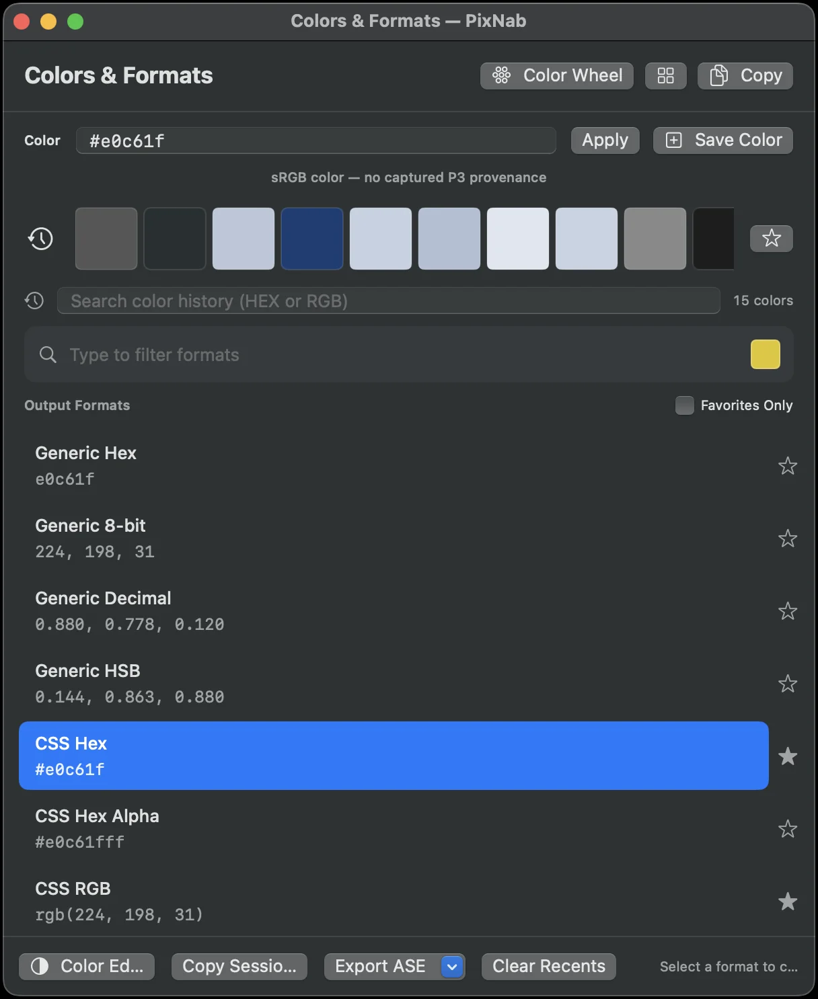

### 7. RGBA editing and native macOS integration

- Compact color editor with separate **red, green, blue**, and **alpha** controls.
- Color-tinted channel sliders and checkerboard transparency feedback.
- Access the native macOS color picker when needed.
- Recent colors, favorites, individual color copying, and a menu-bar entry point that stays out of the Dock by default.
- Configurable global shortcuts for **Pick Color** and **Colors & Formats**.
- Optional **Launch at Login**.

<table>
  <tr>
    <td>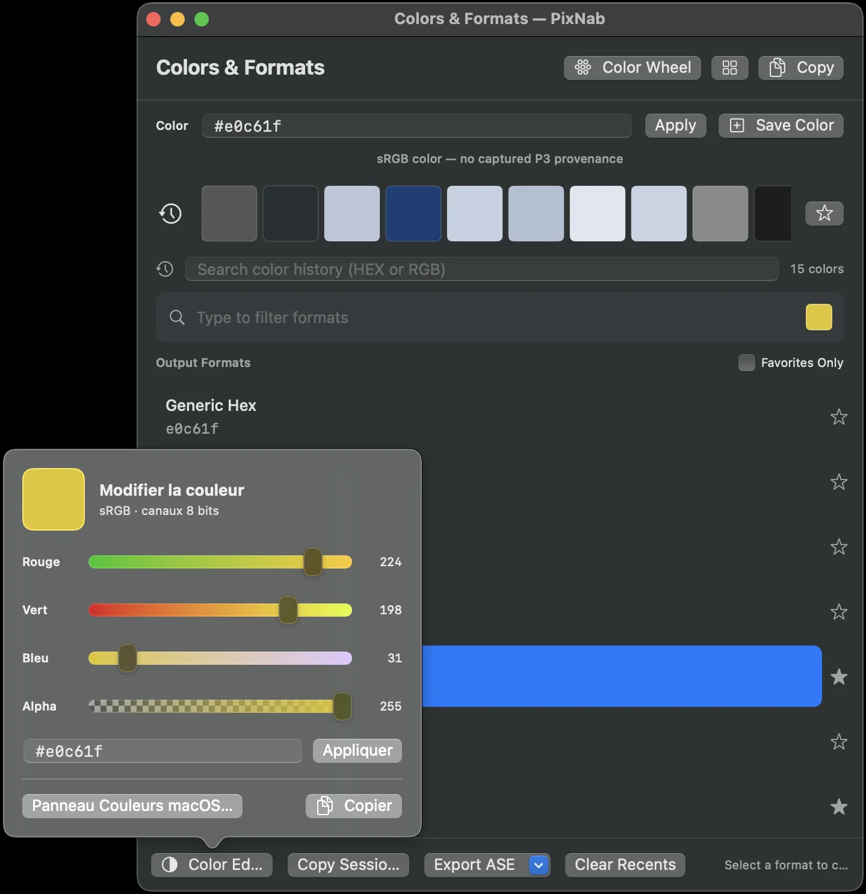</td>
    <td>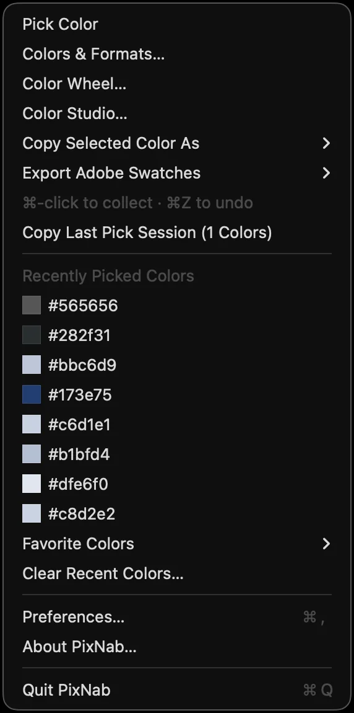</td>
  </tr>
  <tr>
    <td align="center"><strong>RGBA Editor</strong></td>
    <td align="center"><strong>Menu-bar workflow</strong></td>
  </tr>
</table>

### 8. Preferences, localization, and accessibility

Three preference areas are available: **General**, **Appearance**, and **Code Style**.

- **General:** record global shortcuts, select clipboard defaults, configure multi-pick behavior, launch at login.
- **Appearance:** magnifier zoom and size, capture frame rate, color overlay, light/dark/system appearance, language.
- **Code Style:** hexadecimal and floating-point formatting, separators, favorite output formats, live preview.
- Localized interface: **English** and **French**, with an option to follow the system language.
- Native SwiftUI/AppKit controls and accessibility labels in relevant workflows.

> Accessibility support should be verified on the target macOS versions with keyboard navigation, VoiceOver, and the actual display configuration.

## Color handling and accuracy

PixNab uses **ScreenCaptureKit** to sample composited screen pixels while the picker is active. Its capture path handles **SDR, 8-bit/channel** display samples and preserves available **Display P3** components and the capture-time display profile label in relevant saved color workflows. Standard legacy exports use sRGB conversion, while CSS Display P3 output can use preserved P3 components.

Important boundaries:

- The ICC profile of the original document or source application **cannot be reconstructed** from a composited screen pixel.
- HDR luminance sampling and exact source-app ICC provenance are **not supported**.
- Software color conversions are not a substitute for physical calibration of an individual monitor.
- Color metrics, token exports, and WCAG contrast checks address different questions; one does not establish the others.

## Privacy and local-first design

PixNab is designed to work locally, without a user account or cloud service for its core features. The inspected source includes no advertising or analytics SDK.

- **Screen access:** macOS Screen Recording permission is required for color picking. The capture service holds its preview frames in memory rather than automatically saving screenshots.
- **Saved data:** color history, favorites, preferences, and recent pick sessions are stored locally; saved palette collections are managed locally and can be exported.
- **Clipboard:** colors are copied when you perform a copy or pick action. As with any clipboard utility, avoid copying sensitive on-screen information.

See the repository's [privacy notes](docs/PRIVACY.md) for additional implementation details.

## Build from source

**Requirements:** a Mac running macOS 14+, with an Apple Swift toolchain and compatible macOS SDK (Xcode 15.3+ is the baseline documented by the project scripts).

```bash
# From the repository root
chmod +x run.sh

./run.sh --check   # Source checks + Swift Testing + macOS app build
./run.sh --build   # Build dist/PixNab.app and ad-hoc sign for local use
./run.sh           # Build and open PixNab
```

Other available commands:

```bash
./run.sh --test
./run.sh --lint
./run.sh --clean
./run.sh --xcode

./run.sh --cli formats
./run.sh --cli convert '#ff8800' cssOKLCH
```

PixNab uses **Swift Package Manager** and portable **Swift Testing** tests for its shared color logic. The app does not require Node.js, CocoaPods, a backend, or third-party package managers to build from the provided source.

### Project structure

```text
PixNab/
├── Sources/
│   ├── PixNab/            # Native macOS app, UI, capture and services
│   ├── PixNabCore/        # Color math, formats, palettes and data models
│   └── PixNabCLI/         # Developer command-line utilities
├── Tests/PixNabCoreTests/ # Shared logic and regression tests
├── website/               # Public product website (GitHub Pages)
├── .github/workflows/     # macOS checks and website deployment
├── AppInfo.plist           # App bundle metadata and version
├── Package.swift          # Swift Package Manager definition
└── run.sh                 # Build, test and launch helper
```

## Feedback, issues, and contributions

Found a bug, a color conversion issue, or a display-specific problem? Please open a [GitHub issue](https://github.com/Panda-Softs/PixNab/issues) with:

1. Your **macOS version**, Mac model, and PixNab version.
2. The exact steps needed to reproduce the issue.
3. For screen picking bugs: monitor arrangement (left/right/above), resolution, scaling, and which display is primary.
4. Expected versus actual behavior, with screenshots or logs if appropriate. **Do not upload sensitive screen content.**

Contributions are welcome through pull requests; please keep changes focused and include relevant tests or native validation steps. Check existing issues first to avoid duplicate work.

---

<div align="center">

**PixNab v0.23.0** · Built for macOS · Made for people who love color.

**[Explore PixNab](https://panda-softs.github.io/PixNab/)** · **[Latest release](https://github.com/Panda-Softs/PixNab/releases/latest)** · **[Source code](https://github.com/Panda-Softs/PixNab)**

</div>
